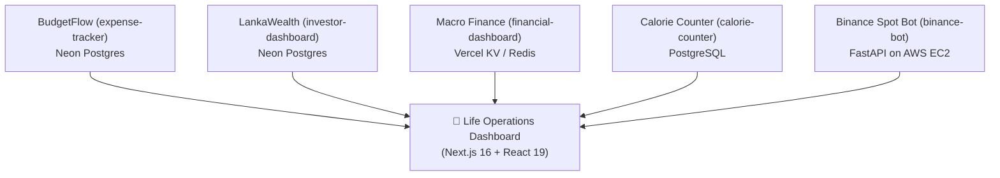

# Life Operations Center (`life-ops-dashboard`)

A unified, high-performance command center synchronizing personal financial health, investments, trading algorithms, and nutrition/wellness under one single dashboard.

## 🚀 Connected Applications & Data Flow



---

## 🌟 Key Features

### 1. Today's Live Pulse Bar (24h Intraday)
- **Calorie & Macro Intake**: Tracks calories against TDEE (`1,600 kcal`), Protein (`135g`), and strict **Sugar Guardrail** (`< 25g`).
- **Fasting Compliance**: Live elapsed intermittent fasting timer vs. `16.0h` target.
- **Hydration & Streak**: Daily water glasses logged + continuous habit streak counter.
- **Intraday Spend vs. Safe Burn Rate**: Today's expense total compared with calculated safe daily allowance for the rest of the month.
- **Binance Bot Heartbeat**: Live wallet balance (USDT), active engine status (`live`/`paper`), and current slot states.

### 2. Cross-Domain "True Freedom" Metrics
- **True FI Coverage (Baseline)**: Computes `Net IIT Passive Income / Actual Rolling Living Expenses` to measure how much of baseline recurring life is covered by passive cash flow right now.
- **Unified Liquid Net Worth**: Aggregates all liquid LKR investments, PFCA USD FDs, and Binance USDT, minus active vehicle/OD/CC debt.
- **Hard Currency Hedge %**: Visualizes USD/USDT hedge percentage against Sri Lankan Rupee devaluation.
- **Food Spend vs. Calorie Overrun Correlation**: Dual-axis graph highlighting dining-out expenditure spikes against weekend calorie & sugar limit breaches.

### 3. FD & Treasury Maturity Radar
- Tracks countdowns for **Fixed Deposits**, **Treasury Bills**, and **Bonds**.
- Color-coded urgency alerts (`< 7 Days` Critical, `< 30 Days` Warning).
- Interactive **"Set Date" modal** allowing manual maturity date overrides without changing upstream database schemas.

---

## 🛠️ Tech Stack & Local Setup

- **Framework**: Next.js 16 (App Router, Turbopack, React 19, TypeScript)
- **Styling**: Tailwind CSS v4, Lucide React icons
- **Charts**: Recharts (Area burn charts, composed dual-axis correlations)
- **Data Connectors**: `@neondatabase/serverless`, `@vercel/kv`, native HTTP fetch with timeout and PIN headers.

### Getting Started

1. Clone or navigate to the directory:
   ```bash
   cd life-ops-dashboard
   ```

2. Review `.env.local`:
   ```env
   APP_PIN=5454
   SESSION_SECRET=your_secret_session_key
   KV_REST_API_URL="https://your-upstash-redis.upstash.io"
   KV_REST_API_TOKEN="your_upstash_token"
   BINANCE_BOT_URL="http://<EC2_IP>:8000"
   BINANCE_BOT_PIN="5454"
   ```

3. Run the development server:
   ```bash
   npm run dev
   ```
   Open **[http://localhost:3000](http://localhost:3000)** and unlock with your PIN (`5454`).

4. Build for production:
   ```bash
   npm run build
   ```

---

## ☁️ Deployment (Recommended: Vercel)

1. Push this directory to your GitHub / GitLab repository.
2. Import the project into **Vercel**.
3. Set your environment variables in Vercel Project Settings (`APP_PIN`, `KV_REST_API_URL`, `KV_REST_API_TOKEN`, `BINANCE_BOT_URL`, `BINANCE_BOT_PIN`).
4. Deploy!
